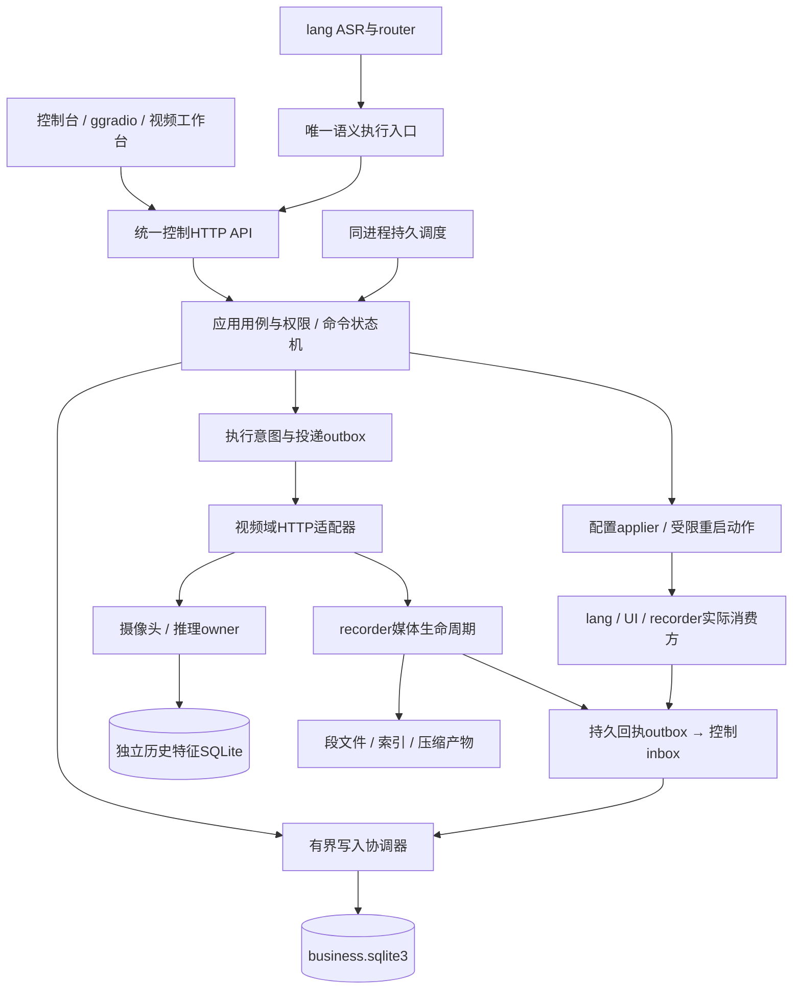

# HA4FPAI重构目标架构

更新：2026-11-06。本文是目标设计，不是已部署架构。实施状态唯一见[重构总清单](REFACTOR-CHECKLIST.md)，起点与证据见[重构历史](REFACTOR-HISTORY.md)。本轮只写本地文档，不执行部署或启动Actions。

## 1. 设计目标与适用边界

目标是统一业务权威和执行合同，同时保留已被验证的硬件与模型实现。不是以代码量、服务数、框架新旧判断架构好坏。即使不考虑工期，也不为了分布式形式给993MB板端引入Redis、Kafka、外置数据库或一组无必要微服务。

- **控制面**：一个模块化控制服务，拥有人员/登记模板、业务设置、命令、确认、事件、持久任务和投影状态的权威。
- **数据面**：摄像头owner、VPU、帧租约、音频流和推理后端保持领域所有权；帧/音频/向量计算的热路径不经业务SQLite和控制HTTP转发。
- **媒体面**：recorder拥有段文件提交、读者租约、压缩、配额与删除日志。业务库保存可查询镜像和关联，不以一行SQL伪装媒体已提交。
- **运行边界**：板端现有Python3.8.10与SQLite3.31.1可承载本轮；不为JSON迁移升级解释器或SQLite。Python升级、ASGI框架替换是独立可测改进，不与资料权威切换绑定。
- **协作边界**：`lang/npuserv`由Qoder维护，当前不改、不导入、不执行其测试；CI全量档若会运行它，不能用作本轮无NPU验证入口。

## 2. 进程与模块

图中的outbox和inbox可由各自域内SQLite表/现有持久日志实现，不表示引入消息中间件。API传控制和元数据；大媒体使用有权限的流式读取，不塞进JSON命令。

### 2.1 模块化单体，而非共享库多进程写

建议模块边界：`domain`定义实体/不变量；`application`编排用例；`repository`封装SQLite；`adapters`连接视频/语音/配置；`transport`负责HTTP与鉴权；`scheduler`只产生到期工作。现有`control/`可分步归入这些边界，不以一次大搬目录为前提。

一个控制进程中，一个写入协调器线程拥有SQLite写连接；多HTTP请求和调度经有界队列提交短事务，读使用明确受限的只读连接/快照。连接不得被多个线程不受控并发复用。队列满给可重试错误及指标；不能无限堆请求。

外部HTTP、NPU、媒体拷贝、TTS和systemctl不能在写事务里等待：事务记录intent → 释放事务 → 域调用 → 事务记结果。进程在两步间退出时留可对账状态，而非承诺跨资源ACID。

当前独立worker会创建另一个App写库，是待修缺陷。目标为调度内置控制进程；将来若确有独立worker需求，只授予内部API调用权，不授予业务库写连接。

### 2.2 并发、幂等与不确定结果

- 命令有request_id/command_id和调用主体；幂等键绑定规范化参数摘要，相同键不同内容409。
- 接受、运行、成功、失败、取消和unknown按明确允许的转换执行。重启后恢复running前先问域服务结果，不能盲目重放有副作用请求。
- 域端也要支持operation_id去重与结果查询；仅控制端记一次命令不能保证远端恰好执行一次。
- outbox至少一次投递、inbox持久去重、重试退避加上限、死信可见、周期对账；旧epoch不得推进新世代。
- 摄像头owner的硬件互斥与语音进程准入锁独立，不用全局锁阻塞整个音视频系统。

## 3. 数据归属与存储选择

| 数据 | 权威/组件 | 格式与规则 |
|---|---|---|
| 人员/身份映射/登记样本 | 控制服务 | business.sqlite3；person_id稳定，名字不是键；样本BLOB显式LE编码并有模型指纹 |
| 命令/任务/设置/事件 | 控制服务 | 同业务库事务；设置desired与applied分离 |
| 检测历史/检索向量 | 视频历史模块 | 复用`model_backend/face_history/store.py`；独立SQLite、FP32归一化向量、容量与pipeline审计 |
| 原图/音频/录像/模型 | 各域文件管理器 | 文件＋哈希/尺寸/根目录身份；数据库只记引用、状态、用途 |
| 录像完成/删除事实 | recorder | 段文件齐备与持久提交日志为事实；控制库镜像回执 |
| 默认参数/硬件/服务地址 | YAML与部署配置 | 版本化启动默认；业务覆盖由DB给出；凭据文件独立 |
| 旧JSON/兼容导出 | 迁移工具/只读投影 | 旧源只读；投影有schema/store/epoch/revision与SHA，不成为第二写库 |
| 帧/流/租约/队列 | owner与运行进程 | 内存/共享内存/流式IPC，不写每帧业务表 |

### 3.1 SQLite写入口与约束

每连接配置并读回`foreign_keys=ON`、`busy_timeout=5000`；文件业务库必须实际进入WAL与FULL。磁盘满、只读、丢盘、锁超时有结构化错误，不退化成空库。

追加迁移补齐：显式非空ID、空名拒绝、整数revision与active、枚举、正dim、BLOB类型/长度、必要JSON字段`json_valid/json_type`。跨表模型一致性由同事务业务校验或经过测试的触发器保证；CHECK不能跨表查询。默认SQLite3.31无STRICT表，不能误把现代版本语法写进迁移。

直接SQL非法写应被库拒绝；模型证据、媒体存在性、撤销/过期等仍需入口与消费侧检查。数据库约束不会消除外部系统、文件和恢复世代的边界验证。

### 3.2 迁移采用JSON1暂存桥

先为每个源做不可变副本和manifest：源仓/文件/schema/大小/SHA/导出时间/模型映射。将原文载入迁移暂存区，先用`json_valid`隔离坏JSON，再按源schema用`json_each`展开、`json_type/json_extract`映射。缺字段、显式null、错类型分别出错；不要在WHERE里悄悄过滤坏人/坏向量而不给行级报告。

SQL负责结构映射；业务用例负责person_id、legacy映射、同名冲突、模型核验、向量有限性/LE编码、权限和审计。导入报告必须计入成功/拒绝/隔离/重复，每一条源记录都能对账。先导入active=0，经明确批准才激活。JSONB非必需，板端也不支持。

### 3.3 备份与运维

在线备份用`sqlite3.Connection.backup()`，不得只复制主DB漏WAL；维护窗口可做检查点，常规使用PASSIVE观察长读阻塞。恢复时验证schema、哈希、媒体manifest，并提升restore_epoch；旧任务/回执/投影不能越代。数据盘UUID、ext4、同设备关系沿用视频源码guard思想；不自动退回SD建新库。

## 4. 指定视频参考与可复用资产

参考根为`S:/work/WCIS/repos/fmql30tai-sdi-npu-face-recognition`，本轮只读核对HEAD `f9e34bcd9f09ea451ce635a21dabb1198d5addbe`。下列路径均相对其`源码/ps_source/`，与HA4FPAI共享工作树无关。源版本不等于板上部署版本，联调前还需核对板端hash。

| 源码 | 已存在能力 | 重构接入方式 |
|---|---|---|
| `npu_photo/camera_owner_runtime.py`及租约配套 | 单owner、frame_id/frame_token、retain/release与stop回执 | 原地复用，统一API不创建第二owner；授权证据必须新鲜且同帧 |
| `npu_photo/serve_photos.py` | `/api/recognize-camera`空POST；图片识别；`/api/enroll`推理并直接gallery.add；DELETE gallery | 识别透传适配；**不能直接拿旧enroll当纯提向量接口**，要拆出无登记副作用的extract，再由控制库提交 |
| `npu_photo/persistent_gallery.py` | ext4/UUID/设备guard，schema2、pipeline校验、原图哈希、fsync+replace、模板缓存 | 迁移复用格式与guard；登记写权切至业务库后它只能消费版本投影，不保留独立JSON写权 |
| `npu_photo/recording_service.py` | 模式/状态、分页、trash/restore/purge、retention/compression、Range 206/416 | 保留域实现；增加服务认证、operation_id、持久回执，不重写已验证读者与文件协议 |
| `npu_photo/recording_library.py` | .trash标记、purging日志、启动续清、读者保护、配额/存储、压缩关联 | 增持久回执outbox与对账，将域结果映射到控制库；JSON侧车作为段manifest保留，不作为另一人员业务库 |
| `model_backend/face_history/store.py` | 已有SQLite WAL/FULL/FK/timeout；512维归一化FP32；BLOB长度CHECK；帧幂等、容量、只读与pipeline核验 | V8从“新建”改为“复用、部署核对、API与event/frame标识对账”；不盲目引入向量数据库/扩展 |
| `lan_stream/vpu_live_server.py`及H264配套 | 预览会话与流式分片路径 | 保留媒体数据面，控制层只做权限/会话/地址和状态投影；浏览器可达URL与Range单独验收 |

现有8093只有Origin检查不等于认证；服务绑定、反向代理和调用主体权限必须明确。回包的内部路径/堆栈/令牌应脱敏，客户端可用URL不能把板内127.0.0.1直接发给板外浏览器。

## 5. 设置、语音与前端

设置键采用显式schema注册：类型/范围/作用域/默认值/是否敏感/热更新或重启/消费方。先事务提交desired，再按版本应用；实际消费方回读并回执才记applied。现在hot键“入库即applied”不可延续。

lang默认YAML保留只读；applier生成专用覆盖文件，保留凭据独立文件，临时写→校验→fsync→replace→消费/重启→回执。失败保旧applied和诊断，重试必须检查最新revision。服务重启通过白名单操作，不接受用户任意shell或路径。

ggradio单改、组合、重置均走API；声纹登记也必须从旧JSON写路径改到统一person_id。语音保留一条语义执行通路：ASR/router → 执行入口 → command → 结构化结果 → TTS；是否经klar薄客户端还是直连桥由实际调用图决定，不在两处重复解释和执行。闲聊/否定/疑问/确认/失败分别有合同，LLM生成文本不冒充执行回执。

前端显示desired/applied/pending/error、命令ID、域状态与未验能力。统一鉴权网关可为浏览器做同源代理/流式转发，媒体不在业务服务内全量缓冲；SSE等通知从有游标的事件读模型派生，断线按游标补读，不以实时通知代替权威状态。

## 6. 发布、验证与退役标准

生产服务由systemd托管，统一安装/数据/凭据布局；日志走有上限journald或logrotate。包提供版本manifest、校验和、保数据升级/卸载、恢复说明；先干净环境验证生命周期，再板上维护窗口部署。

测试层级：纯域与SQL约束 → 实际HTTP合同 → 双进程/断电恢复与故障注入 → 干净包安装 → 板端真实业务链 → 并发长稳/回滚。每份证据绑定源码SHA、环境、数据摘要和退出码；183检查不是183项产品功能，也不代替真实部署。

`archive-2026-11-06`只冻结旧源码，不是生产数据备份；不再开发。删除已合分支不丢提交；rename保留引用、tag也保留可达性，不能把它们描述为必然断历史。切回旧代码若不兼容新DB，必须走已演练的数据兼容/恢复策略，不能reset分支当作完整回滚。
