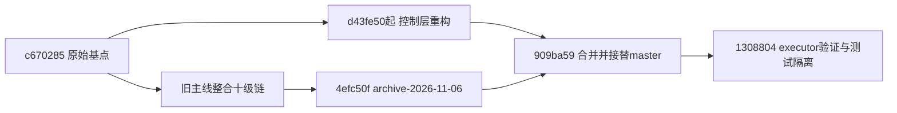

# HA4FPAI重构起点、实施历史与证据

更新：2026-11-06。历史不因清单重排而改写。当前状态与下一步见[重构总清单](REFACTOR-CHECKLIST.md)，设计见[目标架构](REFACTOR-ARCHITECTURE.md)。以下代码提交已用本地Git对象核对；测试读数区分会话记录和可保留原始证据，未经重新运行不写成本次新验收。

## 1. 从哪里转向

| 基准 | 精确值 | 含义 |
|---|---|---|
| 真正重构分叉点 | `c6702855eb229a6e5543db4812887c8628ccb739` | 当时origin/master的CI/打包线；创建unified-control工作树时以它为基点 |
| 旧主线封存分支 | `archive-2026-11-06` → `4efc50f9cdde2720c61d807502647eb514e9c312` | 重构进行后才创建；保存十级链整合、许可证与Qwen3子模块化后的旧主线 |
| 原重构分支 | `unified-control` | 经两次合入旧主线后让master快进；后删分支名，提交仍被master包含 |
| 主线切换提交 | `909ba590c21cf9d624f6f46fd0f3b2c5b291cee0` | 包含4efc50f的合并结果；master快进至此 |
| 后续测试接入提交 | `130880477e06e31450050442296be7d605f58408` | control-adoption经同意快进主线，之后删临时分支/工作树 |
| 本轮只读代码状态 | 本地HEAD=`909ba59`，本地origin/master=`1308804` | 共享树有Qoder等工作，不强行移动HEAD；不能把本地HEAD、远端缓存、网络现场混成一个版本 |
| 视频参考 | 指定目录HEAD=`f9e34bcd9f09ea451ce635a21dabb1198d5addbe` | `repos/fmql30tai-sdi-npu-face-recognition`；只读参考，不复制整树 |

因此准确说法是“从c670285启动重构，后来用archive-2026-11-06冻结切换前旧主线”，**不是先有archive分支再从它开工**。归档点和分叉点不同是正常的。



此图是主干关系示意，完整双亲与中间提交以git log为准。

## 2. 逐阶段实施记录

| 阶段/提交 | 具体做法与组件 | 产生的证据 | 仍未证明的内容 |
|---|---|---|---|
| 阶段01 `d43fe50` | control/store+schema版本迁移、身份映射、样本、设置、命令/确认、事件/导出、HTTP资料服务；视频有意占位 | 版本化SQL、BEGIN IMMEDIATE、WAL/FULL/FK/timeout及模块smoke | 消费方切换、生产数据接管、硬件联调 |
| 阶段02 `838273d` | console/executor通过HA4FPAI_CONTROL_URL走ControlClient；/bridge/text；GET执行入口405 | 真实本机HTTP服务测试、结构化结果 | lang真实ASR/router已调用执行器、TTS/设备全链 |
| 阶段02 `cd9f658` | task worker、epoch栅栏、token-file、systemd单元与部署清单 | 任务模块测试与部署件存在 | 独立worker仍直接开库，与单写进程目标不符；安装路径未一致 |
| 阶段02 `b8ed0bb` | 两格式声纹迁移、旧身份映射幂等、模型登记前置、默认隔离、实体种子工具 | test_migrate 39项（记录） | 真实模型指纹批准、生产切换、所有旧库/图库迁移 |
| 阶段02 `5cdc45d` | V1–V5视频HTTP客户端：识别/快照/播放地址/录像模式/列表回放 | 契约模拟服务37项（记录） | 源码/部署合同漂移、真实帧新鲜度和授权 |
| 阶段02 `2fe8675` | token环境回退、接线与smoke集成 | 多套本机模块检查 | 单机模块通过不等于整机生效 |
| 阶段03 `3f3d231` | 媒体上传与受控读取、recorder回执接收端、迁移apply/实体动作 | smoke88+video37+migrate39（记录） | MIME真实性、视频发送端/状态对账、真实生产导入 |
| 旧主线 `171d101` / `f517d72` | 用户授权把十级链/rms/kws_route/spk/console等未提交工作保存并与CI线合流 | Git祖先和提交记录 | 未自动把新包部署到板端；当时错误归因“别人工作”已被用户纠正 |
| 阶段04 `3bfea68` | 纯Python ar/tar control deb、postinst令牌引导、包结构自检 | packaging12项（记录） | 未做干净环境安装启动/升级卸载；单元仍指向/root |
| 合流 `aa141c9` / `c3a8538` | master合入重构线；control四套挂quick/full矩阵、control进入语法扫描 | c3a8538的Actions三环境作业成功；py3.8 artifact含control四套passed（会话已读取） | 不代表之后新增提交都被同一次Actions测过；不代表生产视频验收 |
| 封存切换 `909ba59` | 再合4efc50f，建立archive分支，master快进，删除unified-control | 本地Git祖先/分支对象，可用git branch --contains复核 | 归档源码不包含业务数据和运行时配置备份 |
| 阶段05 `1308804` | executor真实HTTP失败语义7项；smoke/executor指向隔离死端口；CI注册新套件 | 本机quick104文件语法闸；板端py3.8五套183项（会话记录） | 干净安装、真音频到TTS、生产业务切换与长稳 |

## 3. 已做实验的证据账

| 实验 | 环境/输入/结果 | 结论边界及待补归档 |
|---|---|---|
| 云端CI | c3a8538；Ubuntu py3.8 quick、Ubuntu py3.13 full、Windows py3.13 quick，三个矩阵及总闸success | 只针对该SHA；py3.8 quick artifact九行检查passed。原下载曾放系统TEMP，需带run_id/attempt/sha搬入正式证据索引后长期引用 |
| 目标板模块测试 | 192.168.1.113、Python3.8.10；/tmp/ha4fpai-ctl；88+7+37+39+12=183检查通过 | 是临时服务/临时业务库测试；不是生产安装，不是183项产品能力。日志/脚本/退出码应完整存证；此前tail摘要不代替完整退出码 |
| 真实旧声纹预演 | 本机workenv/ggradio-spk/lang-test/vertify/library.json；192维2人2向量；临时库首遍mapped2/enrolled2，重跑skipped_existing2，active0 | 迁移工具对该文件形状可用；演练注册campplus-real不构成实际模型SHA/预处理核验；生产激活仍未授权通过 |
| SQLite板端探测 | Python sqlite3实际链接3.31.1；json_extract/json_valid可用，jsonb缺失；文件库PRAGMA读回wal/2/5000/1 | 探测脚本workenv/migrate-real-preview/sqlite_probe.py；无需升级SQLite。程序启动时自检与故障验证仍待补 |

## 4. 事故、错误结论与纠正

### 4.1 测试误碰真实视频服务

首次板测smoke84/88、executor6/7：原测试以默认809x作为“不可达”目标，板端真服务存在，断言失败且产生真实请求。1308804改用测试注入地址后183检查通过。**不能仅称“假失败、产品无影响”**：初次请求可能改了录像模式或产生媒体，清单保留现场对账项，不删用户媒体掩盖行为。

后续失败测试用受控stub/保留端口/测试专用服务，确保不会抢占生产端口；绑定后关闭再复用端口存在竞争，强隔离测试还需补强。

### 4.2 空树bump与三级gitlink错误是两件事

先前主库bump中未检查git子命令退出码，read-tree/缓存条目失败后仍commit并push空树`30e26f5`。会话随后将远端恢复到`6ed12b8`，再提交`0ea884d`，后续`a9feba8`。**这只修复了空树，不代表子模块关系正确**。

主库.gitmodules中repos URL是WCIS-FPAI-repos，但其gitlink被误设HA4FPAI的909ba59/1308804。对应对象不在中间仓对象库中；中间仓HA4FPAI条目仍4efc50f。本轮只读确认，列为首要纠错，不能把“diff仅一行”当成正确性证明。

正确恢复采取新提交前向修复，先查远端最新，逐级提交/可取性校验；不再次默认force改共享历史。测试应验证仓库归属、对象可取性、递归clone，不只看SHA和修改行数。

### 4.3 Shell不是唯一根因

git选项应位于子命令前：`git -c http.proxy=... push ...`；先前`git push -c ...`的129是命令用法错误，不是TLS。read-tree的复合rev应加引号、cacheinfo提供完整对象ID，所有关键命令必须失败即停并先核树再推。之前把多次失败都归因PowerShell逗号/CR、并断言bash不会出事，是未经证实的过度归因。

后续可用MSYS bash，但仍须`set -euo pipefail`、精确引用、限制git diff路径和数据边界；不要用tail管道的退出码冒充python/ssh/git退出码。

### 4.4 其他明确纠正

- Git rename保留分支引用；新归档分支/tag都可保留旧提交。此前“互换必然丢历史、Release断链”是错误解释；本次选择归档+快进是用户选定的流程，不是Git唯一安全方式。
- 单写进程目标尚未通过独立worker实现；两个Python进程各有RLock不构成全局单写协调器。
- 只跑包内ar/tar测试不能证明deb可安装启动；/usr/lib与/root路径差异是真实阻断项。
- 视频V8历史库在指定参考源码里已经存在；剩下是复用/版本与部署对齐/统一事件标识，不应再写“历史库未建”。
- 旧wiki阶段页含当时判断与不准确措辞，属于历史；当前纠正与实施状态以本文及总清单为准。

## 5. 只读复核方法

在HA4FPAI根，用MSYS bash运行；这些命令不执行npuserv，也不移动共享HEAD：

```bash
set -euo pipefail
git rev-parse HEAD origin/master archive-2026-11-06
git merge-base c670285 archive-2026-11-06
git merge-base --is-ancestor archive-2026-11-06 origin/master
git log --oneline --all -- control docs boards/console.py klar/klar_executor.py ci/config.json
git diff --name-status archive-2026-11-06 origin/master -- control docs boards/console.py klar/klar_executor.py ci/config.json
```

每次完成清单项：保留准确SHA、输入摘要、命令、环境、原始结果与边界，再更新对应复选框。仅会话声称已跑过而无原始证据的实验，不自动升级为生产验收完成。
